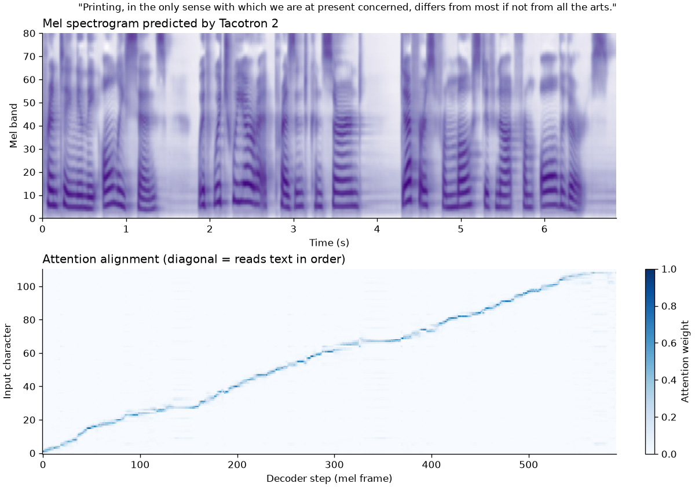
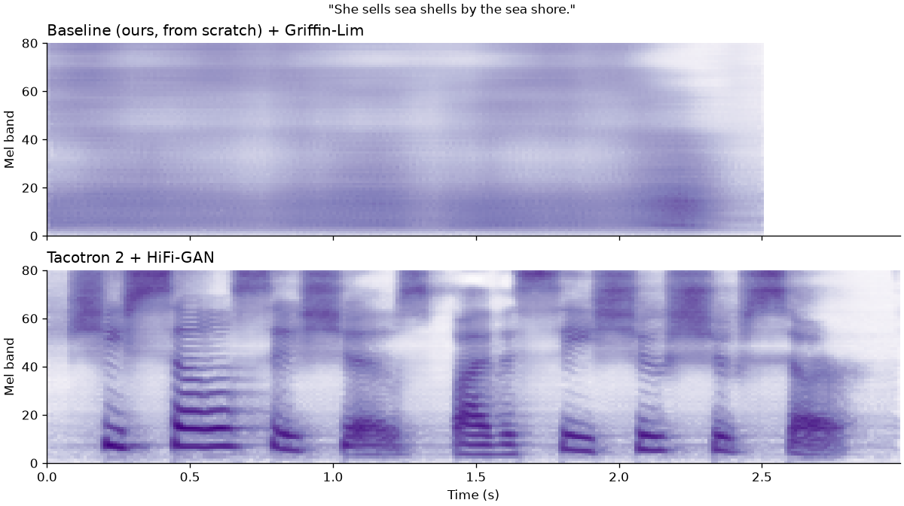
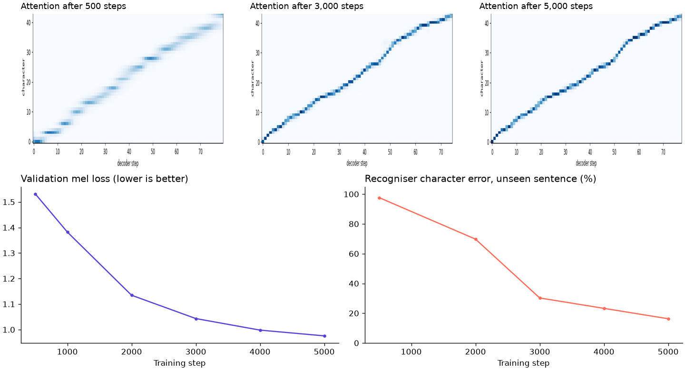
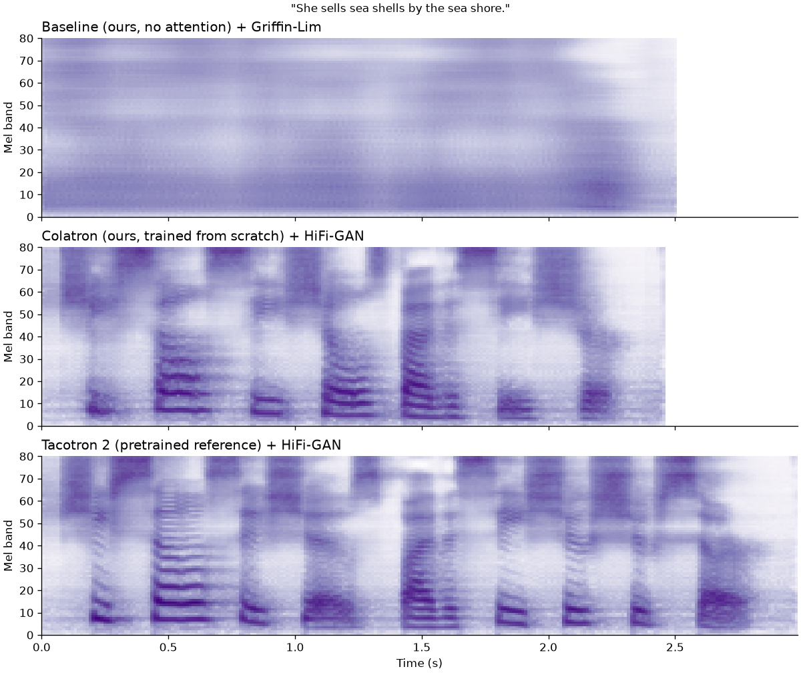

# Colatron: End-to-End Text-to-Speech

UE24CS352A Machine Learning mini-project, PES University (Team 25, Project 20).

**Team:** Mann Mehta (PES2UG24CS266), Marapareddy Deekshitha (PES2UG24CS268)

We revisit the Stanford CS229 (2018) project *"End-to-End Text to Speech Synthesis"*
(Wang, Yang, Li). That project trained SVR, a small neural network, and a seq2seq LSTM
on about 200 LJ Speech sentences and reached a best MOS of 2.5 / 5, with attention that
never aligned (repeated words). We build and train our own seq2seq model with attention,
**Colatron**, from scratch on all 13,100 LJ Speech clips, with a fixed text mapping,
location-sensitive attention and a guided attention loss. We compare it with a
from-scratch baseline that has no attention, and use a pretrained Tacotron 2 only as a
reference.

```
text ──► text cleaning + fixed character ids ──► acoustic model ──► 80-band mel ──► vocoder ──► .wav
                                                 Colatron (ours)                    Griffin-Lim (ours)
                                                 baseline (ours)                    HiFi-GAN (pretrained)
                                                 Tacotron 2 (reference)
```

## What is pretrained and what we wrote

| Component | Source |
|---|---|
| **Colatron** acoustic model (text → mel), seq2seq + attention | **Ours, trained from scratch** on all of LJ Speech |
| Baseline acoustic model (no attention) | **Ours, trained from scratch** on a 404-clip subset |
| Tacotron 2 acoustic model (text → mel), reference only | **Pretrained**: torchaudio `TACOTRON2_GRIFFINLIM_CHAR_LJSPEECH`, trained on all of LJ Speech |
| HiFi-GAN neural vocoder (mel → waveform) | **Pretrained**: SpeechBrain `speechbrain/tts-hifigan-ljspeech` |
| Griffin-Lim vocoder | **Ours**: inverse mel + Griffin-Lim from torchaudio transforms, no learning |
| Shared audio settings, inference pipeline, CLI | **Ours** |
| Attention alignment plots and alignment statistics | **Ours** |
| Fixed-sentence sample generation (same mel through both vocoders) | **Ours** |
| Gradio demo app | **Ours** |
| Data download, text cleaning, mel extraction, splits | **Ours** |
| Evaluation: recogniser word error rate, mel distance, results table | **Ours** (the wav2vec 2.0 recogniser it uses is pretrained, torchaudio `WAV2VEC2_ASR_BASE_960H`) |

We did not train or fine-tune Tacotron 2, HiFi-GAN or wav2vec 2.0. Our trained models are
Colatron and the baseline.

## Setup (Fedora / Linux, CPU only)

Requires **Python 3.11** (PyTorch does not yet support 3.14). On Fedora: `sudo dnf install python3.11`.

```bash
git clone git@github.com:Mann0801/colatron-tts.git
cd colatron-tts
python3.11 -m venv .venv
source .venv/bin/activate
pip install -r requirements.txt
```

Pretrained weights download automatically on first run (about 200 MB in total) to
`~/.cache/torch` and `checkpoints/`. Neither is committed to the repo.

## Usage

### Synthesize one sentence

```bash
python src/infer.py --text "Hello, this is our project." --vocoder hifigan --out outputs/hello.wav
python src/infer.py --text "Hello, this is our project." --vocoder griffinlim --out outputs/hello_gl.wav
```

Prints the mel and alignment shapes, the audio length and the generation time.

### Live demo

```bash
python app/app.py
```

Open http://127.0.0.1:7860, type a sentence, pick a system and press **Speak**. The page
plays the audio and shows the predicted mel spectrogram and attention alignment.
The **Colatron** options need our trained weights at `data/colatron/colatron.pt`, and the
**Baseline** option (which shows its mel under Tacotron 2's) needs `data/baseline/baseline.pt`.
Neither is in git: train them as described below, or copy them from a teammate.
Pre-generated audio in `samples/` is a fallback if the live demo cannot run.

### Regenerate the comparison samples

```bash
python src/generate_samples.py
```

Synthesizes the 10 fixed sentences in `samples/sentences.csv`. Each sentence becomes a mel
spectrogram once (fixed seed), and that same mel goes through both vocoders, so the only
difference between `samples/main_griffinlim/NN.wav` and `samples/main_hifigan/NN.wav` is
the vocoder.

### Attention alignment plots

```bash
python src/plot_alignment.py                      # 3 default sentences
python src/plot_alignment.py --text "Your sentence here."
```

Writes plots to `samples/alignments/` and prints three statistics per sentence:
**monotonic** (share of decoder steps that do not move backwards in the text),
**coverage** (share of characters that were ever the main focus) and **focus**
(mean peak attention weight).



### Baseline vs main system

```bash
python src/plot_mel_comparison.py            # sentence 05; --id 02 for another
```

Plots the mel spectrograms of `samples/baseline/NN.wav` and `samples/main_hifigan/NN.wav`
for the same sentence. The baseline is a smooth blur with no syllables, pauses or pitch
harmonics, which is why it sounds like noise.



### Data and preprocessing

Run from the repository root, in this order:

```bash
python -m src.preprocess.download        # downloads LJ Speech (~2.6 GB), keeps ~400 clips in data/raw/
python -m src.preprocess.prepare         # cleans text, computes mels, writes data/processed/ and the split
python -m src.preprocess.sanity_check    # plots one real mel and resynthesises it with Griffin-Lim
```

- `download.py` keeps a deterministic subset (file-name hash), so every machine gets the same
  clips. `--target-clips 500` changes the size, `--archive PATH` reuses a downloaded archive and
  `--delete-archive` removes the 2.6 GB file afterwards.
- `prepare.py` lowercases and expands the text (`text_cleaning.py`: numbers, money, ordinals,
  years, abbreviations), maps it to a **fixed** 37-symbol character vocabulary, computes
  80-band log-mels with the shared settings, and makes an 80 / 10 / 10 train / val / test split.
  Our run kept **404 clips: 324 train, 40 validation, 40 test**.
- `sanity_check.py` writes a mel plot and original vs Griffin-Lim audio to `eval/outputs/sanity/`.

Try the text cleaner on its own: `python src/preprocess/text_cleaning.py`.

### Colatron (our main model)

```bash
python -m src.preprocess.prepare_full                      # all 13,100 clips -> data/full/ (~10 min, needs the archive)
python -m src.models.colatron train --out-dir data/colatron_r3        # trains; Ctrl+C any time
python -m src.models.colatron train --out-dir data/colatron_r3 --resume   # continue later
python eval/intelligibility.py watch --run data/colatron_r3   # optional, in another terminal
cp data/colatron_r3/colatron.pt data/colatron/colatron.pt     # the weights the demo and eval use
python -m src.models.colatron generate                     # samples/colatron_griffinlim/ and colatron_hifigan/
python src/report_figures.py --run data/colatron_r3        # training figure, alignment plot, stats
```

`prepare_full.py` extracts every clip from `data/LJSpeech-1.1.tar.bz2` (run
`python -m src.preprocess.download` once to get it), computes all mels in parallel and stores them
as one float16 array (1.2 GB). The split is 12,960 train / 100 validation / 40 test, and the 40
test clips are exactly the baseline's test clips, so every system is scored on the same unseen
sentences.

Model (`src/models/colatron.py`, about 7.4M parameters, Tacotron 2 style but smaller):

- **Encoder:** character embedding (256), 3 × Conv1D (256, kernel 5, batch norm, dropout 0.5), BiLSTM (2 × 128).
- **Decoder:** prenet (256, 128, dropout kept on at inference), attention LSTM (512),
  **location-sensitive attention**, decoder LSTM (512), linear output of `r` mel frames per step
  (reduction factor, default 3) plus a stop token.
- **Post-net:** 5 × Conv1D (256, kernel 5) residual.
- **Loss:** L1 + MSE on normalised mels (before and after the post-net) + stop-token BCE +
  **guided attention loss** (Tachibana et al., 2017), which penalises attention far from the diagonal.
- **Training:** teacher forcing, Adam 1e-3 (halving every 8k steps after step 8k), batch 32 with
  length bucketing, gradient clipping 1.0, best-validation checkpoint. It runs on a laptop CPU at
  roughly 700 steps per hour (6 threads); every 500 steps it saves `latest.pt`, the best `colatron.pt`
  and a monitor plot and audio clip in `<out-dir>/monitor/`.

### Baseline model

```bash
python -m src.models.baseline train      # trains, saves data/baseline/baseline.pt
python -m src.models.baseline generate   # synthesises samples/sentences.csv into samples/baseline/
```

A deliberately weak text-to-mel model trained from scratch on the subset: character embedding
(128-d), three 1-D convolutions (256 channels, kernel 5), linear interpolation of the character
features to the target number of frames (**no attention**), and an MLP to 80 mel bands. L1 loss
on per-band normalised mels, Adam (lr 1e-3), gradient clipping 1.0, batch 16, 60 epochs, best
validation checkpoint kept. Audio comes from the Griffin-Lim vocoder.

### Evaluation

```bash
python eval/intelligibility.py score   # recogniser word / character error rate on 20 test clips
python eval/objective.py               # mel distance on the same 20 test clips
python eval/results_table.py           # writes eval/results/results_table.md
```

- `intelligibility.py score` lets a pretrained wav2vec 2.0 speech recogniser (never trained on LJ
  Speech) transcribe each system's audio and the real recording, and reports the word and character
  error rates against the requested sentence (lower is better). Output goes to
  `eval/results/intelligibility.csv`. `intelligibility.py watch` does the same on 5 clips for every
  new checkpoint of a training run.
- `objective.py` converts each system's audio to a mel, aligns it with the real recording's mel
  using dynamic time warping, and reports mean L1 and RMSE (lower is better). Output goes to
  `eval/results/objective.csv`. Both scripts score the baseline, Colatron and Tacotron 2, each
  through Griffin-Lim and HiFi-GAN where possible, so every comparison has a same-vocoder partner.
- `results_table.py` turns those numbers into the Markdown table in `eval/results/results_table.md`.

## Audio settings

All parts of the project share `src/audio_config.py`, which matches the pretrained
Tacotron 2 and HiFi-GAN:

| Setting | Value |
|---|---|
| Sample rate | 22,050 Hz |
| FFT size / window / hop | 1024 / 1024 / 256 samples |
| Mel bands | 80, slaney scale and norm, 0 to 8000 Hz |
| Stored as | natural log of magnitude, `log(clamp(mel, 1e-5))` |

## Results

Measured on a 24-core laptop CPU, no GPU.

### Main results (20 held-out test clips, lower is better)

Colatron checkpoint: step 18,000, 5.3 h of training in total (laptop CPU for the first 1,000
steps, then a free Google Colab T4 GPU). The write-up submitted on 13 Oct reports the earlier
step-5,000 checkpoint (WER 25.2%, CER 10.3%); training continued afterwards.

| System | WER | CER | Mel L1 | Mel RMSE |
|---|---|---|---|---|
| Real recording | 5.1% | 1.7% | - | - |
| Baseline (ours, no attention) + Griffin-Lim | 99.8% | 94.8% | 1.217 | 1.527 |
| **Colatron (ours, from scratch) + Griffin-Lim** | 9.3% | 3.0% | **0.816** | **1.081** |
| **Colatron (ours, from scratch) + HiFi-GAN** | **8.8%** | **2.8%** | 0.832 | 1.101 |
| Tacotron 2 (pretrained reference) + Griffin-Lim | 17.6% | 8.7% | 0.878 | 1.174 |
| Tacotron 2 (pretrained reference) + HiFi-GAN | 16.2% | 7.8% | 0.901 | 1.206 |

WER / CER: word / character error rate of a wav2vec 2.0 speech recogniser on the generated audio
(`eval/intelligibility.py`). Mel L1 / RMSE: DTW-aligned distance to the real recording's mel
(`eval/objective.py`). Colatron's attention on three unseen sentences is 99 to 100% monotonic
with 93 to 98% character coverage (`src/report_figures.py`).





### Vocoders and the pretrained reference

| Vocoder | Type | Time for 3 to 7 s of audio | Notes |
|---|---|---|---|
| WaveRNN (tried, removed) | autoregressive neural | ~49 s for 3.3 s | too slow for a live demo |
| Griffin-Lim | signal processing | 0.06 to 0.10 s | intelligible, metallic |
| HiFi-GAN | parallel neural (GAN) | 0.43 to 1.04 s | natural; about 7× faster than real time |

Tacotron 2's attention on the same 3 sentences: **95 to 97% monotonic**, 84 to 88% character
coverage. A clean diagonal means the model reads the text in order, which the original
project's seq2seq model never achieved.

Tacotron 2 was pretrained on all of LJ Speech, so it may have seen the test clips (see
Limitations). Colatron never trains on them.

## Repository structure

```
src/
  audio_config.py        shared mel settings
  infer.py               CLI: text -> wav
  generate_samples.py    fixed sentences through both vocoders
  plot_alignment.py      mel + attention plots and alignment stats
  plot_mel_comparison.py baseline vs main system mel spectrograms
  report_figures.py      Colatron training figure, alignment plot and stats
  models/
    colatron.py          our seq2seq model with attention, trained from scratch
    tacotron.py          pretrained Tacotron 2 wrapper (reference)
    baseline.py          our baseline without attention, trained from scratch
  vocoder/
    griffinlim.py        Griffin-Lim vocoder
    hifigan.py           pretrained HiFi-GAN wrapper
  preprocess/            download, text cleaning, mel extraction, split, sanity check
app/app.py               Gradio demo
eval/                    recogniser word error rate, mel distance and results table
samples/                 committed demo audio (main_griffinlim/, main_hifigan/, baseline/) and plots
report/                  slides and write-up
data/, checkpoints/, outputs/   gitignored
```

## Who did what

| Member | Parts | Files |
|---|---|---|
| Mann Mehta | Colatron model and training, full-corpus preprocessing, intelligibility evaluation, pipeline setup, vocoders, alignment analysis, samples, inference CLI, demo, README | `src/models/colatron.py`, `src/preprocess/prepare_full.py`, `eval/intelligibility.py`, `src/report_figures.py`, `src/models/tacotron.py`, `src/vocoder/`, `src/infer.py`, `src/plot_alignment.py`, `src/plot_mel_comparison.py`, `src/generate_samples.py`, `src/audio_config.py`, `app/`, `README.md` |
| Marapareddy Deekshitha | Data, preprocessing, baseline model, evaluation | `src/preprocess/`, `src/models/baseline.py`, `eval/` |

## Limitations

- Colatron trained for under a day on a laptop CPU, so it sounds robotic compared with the
  pretrained Tacotron 2, which trained for days on GPUs.
- Tacotron 2 and HiFi-GAN are pretrained on the full LJ Speech dataset, so LJ Speech
  test sentences may have been seen during their training. Scores on those clips favour
  the pretrained system. Colatron never trains on them.
- The speech recogniser is a proxy for human listeners; there is no MOS listening test.
- Tacotron 2 keeps dropout on in its prenet at inference, so repeated runs differ slightly.
  `generate_samples.py` fixes a seed for reproducibility.
- Single speaker (LJ Speech), English only.

## References

1. X. Wang, Y. Yang, Y. Li. *End-to-End Text to Speech Synthesis.* CS229 project report, Stanford, 2018.
2. J. Shen et al. *Natural TTS Synthesis by Conditioning WaveNet on Mel Spectrogram Predictions* (Tacotron 2). ICASSP 2018.
3. J. Kong, J. Kim, J. Bae. *HiFi-GAN: Generative Adversarial Networks for Efficient and High Fidelity Speech Synthesis.* NeurIPS 2020.
4. D. Griffin, J. Lim. *Signal Estimation from Modified Short-Time Fourier Transform.* IEEE TASSP, 1984.
5. K. Ito, L. Johnson. *The LJ Speech Dataset.* 2017.
6. Y. Wang et al. *Tacotron: Towards End-to-End Speech Synthesis.* Interspeech 2017.
7. H. Tachibana, K. Uenoyama, S. Aihara. *Efficiently Trainable Text-to-Speech System Based on Deep Convolutional Networks with Guided Attention.* ICASSP 2018.
8. A. Baevski et al. *wav2vec 2.0: A Framework for Self-Supervised Learning of Speech Representations.* NeurIPS 2020.
